<h2 id="watch" class="reveal">Watch the session</h2>

<figure class="video-card reveal">
<video controls preload="metadata" playsinline poster="/assets/images/chillhop/walkthrough-poster.jpg" aria-label="Night Shift Vinyl walkthrough">
<source src="/assets/videos/chillhop-walkthrough.mp4" type="video/mp4">
</video>
<figcaption>Walkthrough: the full session from START SESSION to SESSION MASTERED, recorded in a Quest 3 with hand tracking. That is me playing it, bottom right.</figcaption>
</figure>

<h2 id="summary" class="reveal">Summary</h2>

<b>Night Shift Vinyl</b> is a stationary VR task simulation for Meta Quest, controlled entirely with optical hand tracking, no controllers. You stand (or sit) behind a warm, mood-lit vinyl DJ desk and build a lo-fi track one gesture at a time: load a record, drop the needle, tap a drum pad, open a filter, push up the master fader. Every step is a real, tactile hand action, and every step changes what you hear.

<b>Why it suits hand tracking</b>Nothing moves you through space and nothing needs a fast arm swing. Every interaction is a natural gesture your hands already know: pinch an edge, set something down, poke a soft pad, turn a knob, push a slider.

<table class="reveal">
<tr><th>Project title</th><td>Night Shift Vinyl: Lo-Fi Vinyl Lounge</td></tr>
<tr><th>Platform</th><td>Meta Quest 3, optical hand tracking only</td></tr>
<tr><th>Engine</th><td>Unity 6, XR Interaction Toolkit 3.x, OpenXR, XR Hands</td></tr>
<tr><th>Interactions</th><td>5 required, plus a start menu and a conclusion</td></tr>
</table>

<h2 id="session" class="reveal">The Session</h2>

A floating wooden panel above the desk welcomes you and lists the five steps. Poke the <b>START SESSION</b> button and the checklist comes alive: the step you are on glows amber with a one-line how-to underneath, and finished steps tick off in green. The control you need next also gets a soft pulsing outline, so you never have to guess what to touch. <b>Poke</b> means press with one fingertip; <b>pinch</b> means thumb and index finger together.

<small>Checklist panel</small>
<b>[X]</b> 1. Load Vinyl Platter 
[ ] 2. Drop the Stylus Needle 
[ ] 3. Trigger Beat Sample Pad 
[ ] 4. Open Low-Pass Filter 
[ ] 5. Push Master Output Fader

<ol class="tracks reveal">
  <li><h3>Load Vinyl Platter</h3>Pinch · Place
Pinch the record out of its sleeve and set it on the platter. A trigger zone waits for you to let go, then glides the disc onto the spindle. The platter spins up smoothly and a quiet motor hum starts.
</li>
  <li><h3>Drop the Stylus Needle</h3>Pinch · Swing
Pinch the tonearm handle and swing the arm over the spinning record. When the needle is over the groove it drops into contact: surface crackle fades in, then a muted lo-fi drum beat follows.
</li>
  <li><h3>Trigger Beat Sample Pad</h3>Poke · Tap
Tap the big orange silicone pad with your index finger. It depresses under your fingertip, flashes neon amber, and a warm electric piano loop enters on the next bar, locked to the drums.
</li>
  <li><h3>Open Low-Pass Filter</h3>Pinch · Twist
The mix starts muffled at 800 Hz. Pinch the chunky analog dial and turn it a quarter turn, either way, and the cutoff sweeps up to 20,000 Hz, opening the mix to full fidelity.
</li>
  <li><h3>Push Master Output Fader</h3>Pinch · Push
Pinch the flat fader on the front edge of the board and slide it from the left (30 percent volume) to the right (100 percent), like a real DJ mixer. The master level swells with your hand.
</li>
</ol>

<h3 class="reveal">The finale</h3>

When the last step lands, the warm golden desk lamp dims and colored neon accents begin to pulse slowly with the beat. A slate drops in from above reading <b>SESSION MASTERED - 100% GROOVE</b>, shows your session time, and offers a <b>RESTART SESSION</b> poke button that puts the whole room back exactly as it was. An <b>EXIT GAME</b> poke button sits under the checklist the whole time, so a hands-only player can always leave.

<h2 id="hands" class="reveal">Hand Tracking</h2>

These are the interactions I am proudest of, and why they feel physical even though there is nothing in your hands.

  
Tonearm<h3>A hinge, not a handle</h3>
The arm is a real hinge. The script measures the angle of your pinch point around the pivot, frame by frame, so the arm follows your hand like it is on a bearing. Let go early and it glides back to rest. Get the needle over the groove and it settles into the groove and the crackle swells. No button, no trigger: the position of your hand is the whole control.

  
Filter dial<h3>Twist it or orbit it</h3>
Pinch the dial and either roll your wrist or circle your hand around it. The script measures both, uses whichever moved more, and counts a turn in either direction, with a little gain so a short twist is enough. Because it tracks the change in angle, a lost tracking frame never makes it jump. The sweep is exponential, so the first turn is as audible as the last.

  
Drum pad<h3>Depress and flash</h3>
The pad cap travels with your fingertip and only fires once it passes 80 percent of its travel, so brushing it does nothing. Once it fires it flashes amber, and it springs back when you lift your finger. Poking is a different gesture from pinching on purpose, so the two never get confused.

  
The record<h3>It can never get lost</h3>
The record follows your hand but cannot sink through the desk, the deck, the mixer or the crate, and when you let go it settles flat on the surface below. Let go anywhere that is not over the desk and it glides back to the crate. Controls are also generous to pinch (big invisible colliders) but only count at the right moment, so touching the filter early politely does nothing.

<b>No haptics, so the world answers back</b>Hands cannot rumble, so feedback is built into sound and light: a chime on every step, the pad flash, the platter hum, the crackle fading in, a pulsing outline on the next control. On controllers the same events also send a haptic pulse.

<b>Tuned on a real headset</b>Playtesting on a Quest 3 changed several things: the sample rig only counted a pinch at a perfect 1.0 strength, which optical tracking almost never reports, so a pinch now registers at 80 percent. The player is scaled up 25 percent so the whole desk is within arm's reach, and the headset's high-frequency hand tracking is requested in the manifest.

<h2 id="media" class="reveal">Media</h2>

Stills from the real headset recording and from the Unity scene. Click an image to enlarge it, and use the arrow keys to flip through.

<figure>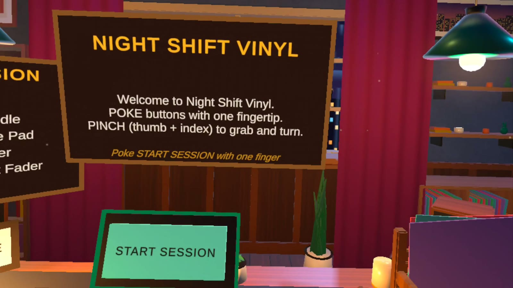<figcaption>Headset view: the welcome panel, checklist and START SESSION button, with the next control outlined.</figcaption></figure>
<figure>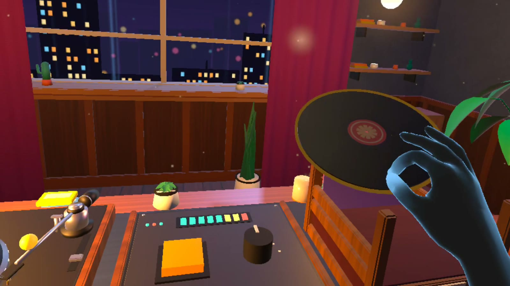<figcaption>Step 1: pinching the record out of its crate to carry it to the platter.</figcaption></figure>
<figure>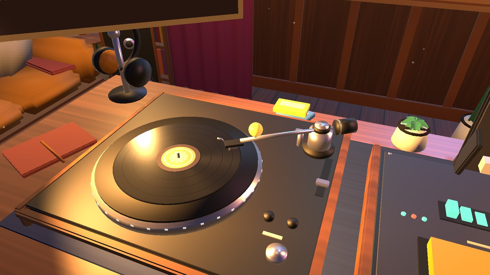<figcaption>Step 2: pinching the tonearm handle and swinging the needle over the record.</figcaption></figure>
<figure>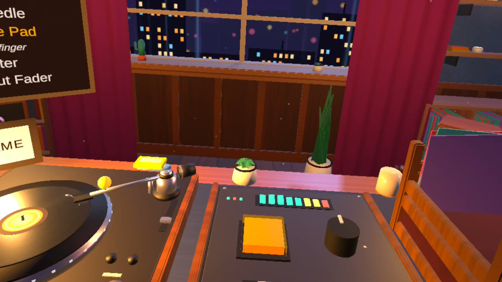<figcaption>Step 3: the big orange pad, the level meter above it and the dial beside it.</figcaption></figure>
<figure>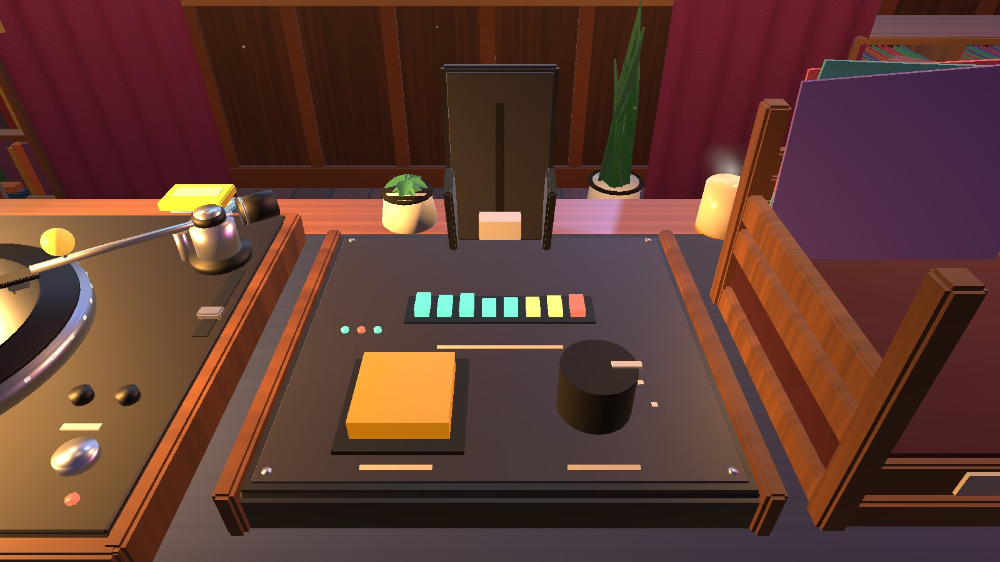<figcaption>Step 4: a pinch and twist on the low-pass dial.</figcaption></figure>
<figure>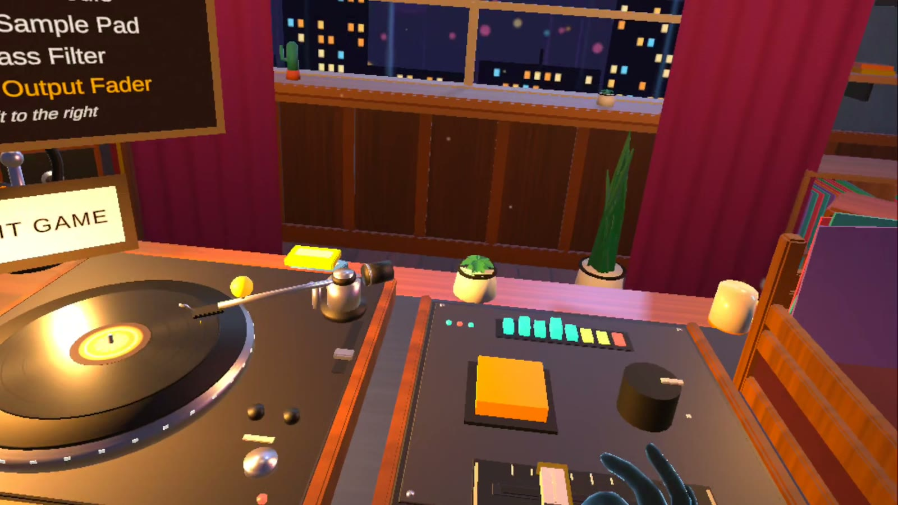<figcaption>Step 5: sliding the flat master fader along the front edge of the board.</figcaption></figure>
<figure>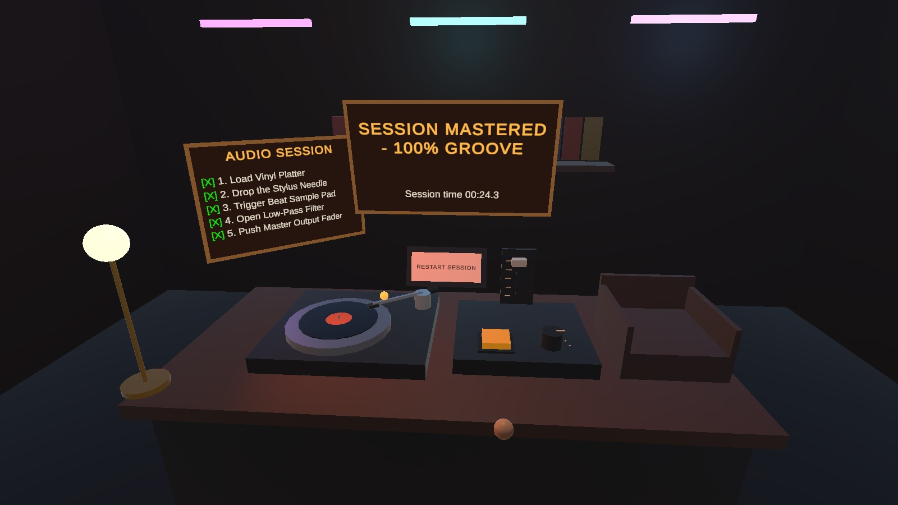<figcaption>The finale: lamp dimmed, neon pulsing, SESSION MASTERED with a RESTART button.</figcaption></figure>
<figure>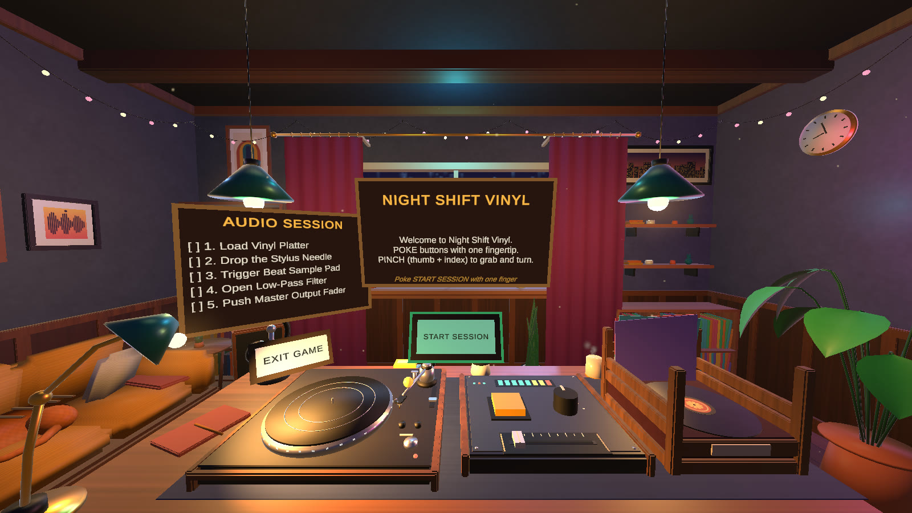<figcaption>The whole room from where you stand: window, curtains, pendant lamps, couch and the deck.</figcaption></figure>
<figure>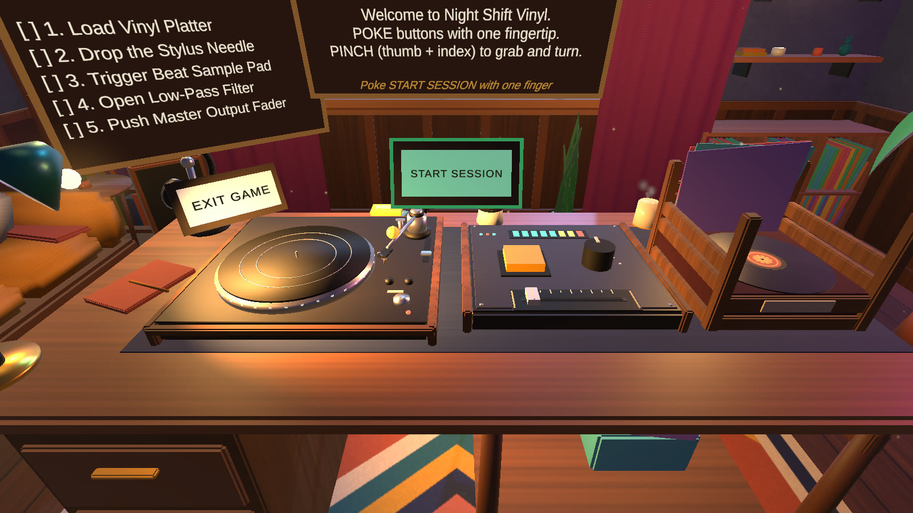<figcaption>The desk from above: turntable, mixer with level meter, pad, dial and fader, and the record crate.</figcaption></figure>
<figure>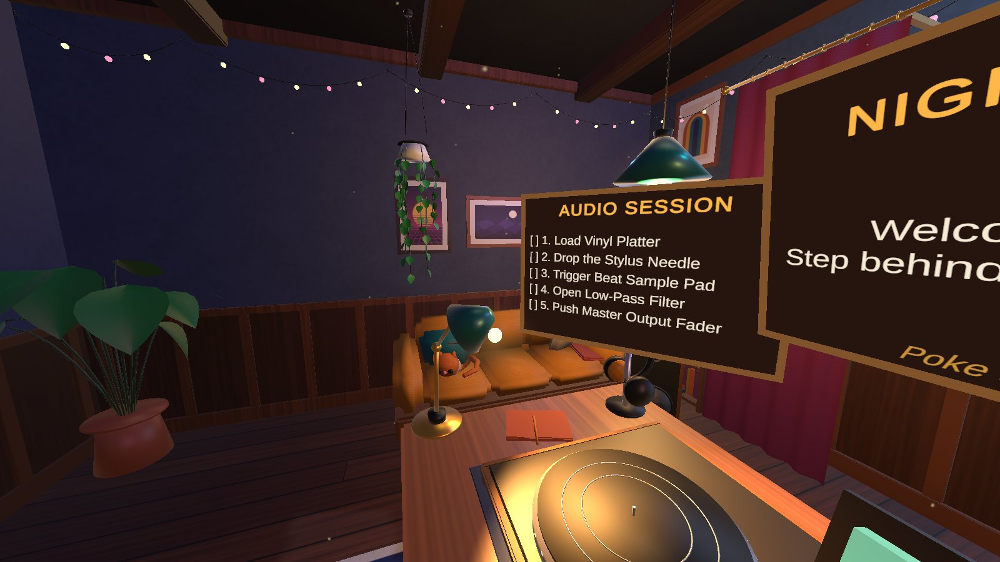<figcaption>The couch corner: a sleeping cat, string lights, a hanging pothos and framed posters.</figcaption></figure>
<figure>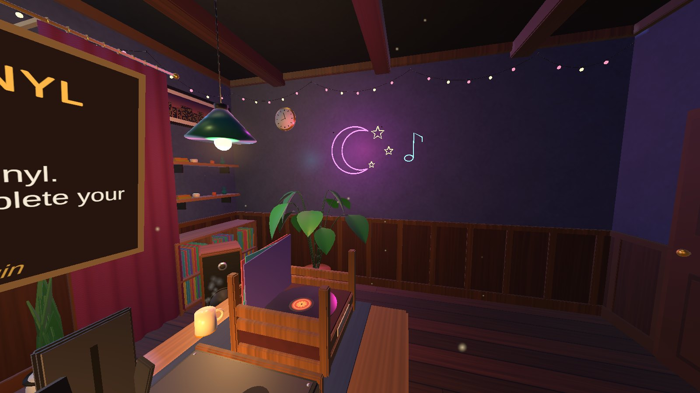<figcaption>The neon wall: a glowing moon, stars and music note, a record rack and a monstera.</figcaption></figure>
<figure>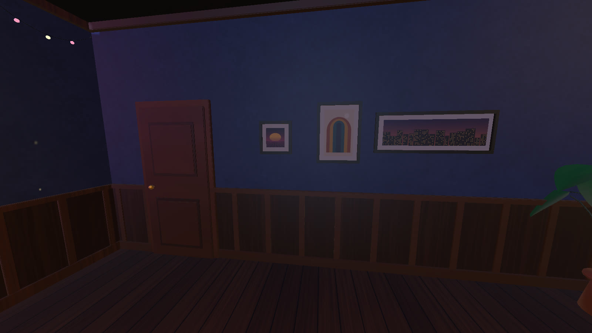<figcaption>Behind the player: the door, three posters and the wainscoting, so every direction has something to look at.</figcaption></figure>

<h2 id="code" class="reveal">Code</h2>

About twenty small C# scripts drive everything (the room's lights, speakers and plants are scripts too). The central one is a state machine that only accepts steps in order, so no interaction can be done early. These three pieces show the hand-tracking ideas. I compiled the scripts against XR Interaction Toolkit 3.6 in Unity 6 and ran them in Play mode with 27 automated checks for the step order, snap zone, poke button, knob, fader, tonearm and reset, all passing, then tuned the feel on a real Quest 3.

<table class="reveal">
<tr><th>Link to code</th><td><a href="https://github.com/moff05/cim423-3d-world/tree/main/assets/code/chillhop" target="_blank" rel="noopener">github.com/moff05/cim423-3d-world / assets / code / chillhop</a></td></tr>
<tr><th>Built with</th><td>Claude Code (Anthropic) wrote the C#, the Blender models, the textures and the audio from my direction, and the Quest build was tuned on a real headset. The scene is rebuilt from code by <code>ChillhopBuilder</code> and <code>ChillhopDecor</code>, both in the repo above.</td></tr>
</table>

<h3>1. The filter dial follows your hand</h3>
Each frame it measures how far your pinch point has orbited the dial, and how far your wrist has rolled, since the last frame, and adds whichever moved more. A missed frame costs nothing, because it only ever applies the change.
<pre><code>void UpdateRotary()
{
    float orbit = Vector3.SignedAngle(prevDir, dir, axisWorld);        // hand circling the dial
    prevDir = dir;

    // wrist twist: how much the pinching hand itself rolled about the dial axis
    float twist = 0f;
    if (VRDragMath.TryPlanarDirection(attach.position + attach.right, attach.position, axisWorld, out Vector3 tw))
    {
        if (hasPrevTwist) twist = Vector3.SignedAngle(prevTwist, tw, axisWorld);
        prevTwist = tw;
        hasPrevTwist = true;
    }

    float delta = (Mathf.Abs(twist) &gt; Mathf.Abs(orbit) ? twist : orbit) * rotarySensitivity;
    turn = Mathf.Clamp(turn + delta, bothDirections ? -rotaryRange : 0f, rotaryRange);
    SetValueInternal(Mathf.Abs(turn) / rotaryRange, true);
}</code></pre>

<h3>2. The record lands on the platter</h3>
The zone waits until you let go, switches off the grab, freezes the physics, then glides the disc onto the snap point and advances the checklist.
<pre><code>IEnumerator SnapRoutine(Rigidbody rb, XRGrabInteractable grab)
{
    busy = true;
    inside.Remove(rb);

    // Order matters: disable the grab first (XRI restores Rigidbody settings when it lets go),
    // then freeze physics.
    if (grab != null) grab.enabled = false;
    rb.linearVelocity = Vector3.zero;
    rb.angularVelocity = Vector3.zero;
    rb.isKinematic = true;

    Transform t = rb.transform;
    Transform target = snapPoint != null ? snapPoint : transform;
    if (parentToSnapPoint) t.SetParent(target, true);

    Vector3 fromPos = parentToSnapPoint ? t.localPosition : t.position;
    Quaternion fromRot = parentToSnapPoint ? t.localRotation : t.rotation;
    Vector3 toPos = parentToSnapPoint ? Vector3.zero : target.position;
    Quaternion toRot = parentToSnapPoint ? Quaternion.identity : target.rotation;

    float elapsed = 0f;
    while (elapsed &lt; snapSeconds)
    {
        elapsed += Time.deltaTime;
        float k = Mathf.SmoothStep(0f, 1f, Mathf.Clamp01(elapsed / snapSeconds));
        if (parentToSnapPoint)
        {
            t.localPosition = Vector3.Lerp(fromPos, toPos, k);
            t.localRotation = Quaternion.Slerp(fromRot, toRot, k);
        }
        else
        {
            t.SetPositionAndRotation(Vector3.Lerp(fromPos, toPos, k), Quaternion.Slerp(fromRot, toRot, k));
        }
        yield return null;
    }

    if (parentToSnapPoint) t.SetLocalPositionAndRotation(toPos, toRot);
    else t.SetPositionAndRotation(toPos, toRot);

    snapRoutine = null;
    onSnapped.Invoke();
    if (VinylSimulationManager.Instance != null) VinylSimulationManager.Instance.AdvanceStep(expectedStep);
    // busy stays true until reset: the record is locked in.
}</code></pre>

<h3>3. The piano locks to the beat</h3>
When the pad is tapped, the keys loop is scheduled on the audio clock for the exact moment the drum loop wraps, so the two never drift apart. The filter then maps 0 to 1 onto 800 to 20,000 Hz on a curve.
<pre><code>IEnumerator StartKeysInSync()
{
    keysSource.volume = 0f;

    if (drumSource != null &amp;&amp; drumSource.isPlaying &amp;&amp; drumSource.clip != null)
    {
        double pitch = Mathf.Max(0.01f, Mathf.Abs(drumSource.pitch));
        double remaining = (drumSource.clip.samples - drumSource.timeSamples) / (double)drumSource.clip.frequency / pitch;
        double startAt = AudioSettings.dspTime + remaining;
        keysSource.PlayScheduled(startAt);
        while (AudioSettings.dspTime &lt; startAt) yield return null;
    }
    else
    {
        keysSource.Play();
    }

    yield return Fade(keysSource, keysLevel, fadeSeconds * 0.5f);
}

void ApplyCutoff()
{
    if (lowPass == null) return;
    lowPass.cutoffFrequency = minCutoff * Mathf.Pow(maxCutoff / minCutoff, cutoffNormalized);
}</code></pre>

<h2 id="setup" class="reveal">Setup</h2>

The full step-by-step wiring guide is in the repo (<a href="https://github.com/moff05/cim423-3d-world/blob/main/assets/code/chillhop/SETUP.md" target="_blank" rel="noopener">SETUP.md</a>). The short version:

Player rig: hands, poke and direct interaction

<ul>
<li>Use the XRI sample rig <b>XR Origin Hands (XR Rig)</b>. Delete locomotion and teleport so the scene stays stationary. Also import the XR Hands package sample <b>HandVisualizer</b>: the rig's hand models need its script.</li>
<li>Add an <b>Input Action Manager</b> to the scene and give it the <i>XRI Default Input Actions</i> asset. Without it nothing enables the pinch action, and the hands see objects but cannot grab them.</li>
<li>The rig's pinch reader asks for a perfect 1.0 strength. Set each <code>ReleaseThresholdButtonReader</code> to press 0.8 and release 0.6 so ordinary optical pinches register.</li>
<li>Keep each hand's <b>Near-Far Interactor</b> (pinch, near and far) and <b>Poke Interactor</b>. In XRI 2.x the near interactor is the XR Direct Interactor.</li>
<li>Under each Poke Interactor's attach point, add a small child with <code>VRFingertip</code> (trigger sphere, kinematic Rigidbody, radius 8 mm). The drum pad and the START and RESTART buttons feel this.</li>
<li>On the camera, keep the Audio Listener and add an <b>Audio Low Pass Filter</b>.</li>
</ul>

Keeping the record from glitching under optical tracking

<ul>
<li>Vinyl Rigidbody: <b>Kinematic</b>, no gravity. The record never falls, bounces or gets thrown, so it cannot tunnel through anything.</li>
<li><code>HeldSurfaceClamp</code> holds a short list of surface rectangles (desk, deck, mixer, crate floor, each with a minimum height). While held, the record cannot go below the surface under it; on release it settles onto that surface and lies flat; released away from the desk it glides back to the crate.</li>
<li>Collider: a thin box for the disc plus a thicker pinch zone above it, so a pinch near the record counts.</li>
<li>XR Grab Interactable: <b>Kinematic</b> movement with smoothing on and throw off. This filters out hand jitter.</li>
<li>Tonearm, knob and fader handles: Simple Interactable, kinematic Rigidbody, generous 7 to 8 cm colliders.</li>
<li>Build settings: add an <code>Assets/link.xml</code> that preserves the XR Hands and XR Interaction Toolkit assemblies, and keep managed stripping at Minimal. Without it IL2CPP strips the hand-tracking components that only appear inside prefabs, and the hands never move on the headset.</li>
</ul>

Hierarchy for audio and UI

<ul>
<li><b>Audio</b>: a <code>VinylAudioController</code> object with four child AudioSources (hum, crackle, drums, keys; all looping, 2D) plus a UI chime source with Bypass Listener Effects on.</li>
<li><b>UI</b>: three World-Space canvases (intro, checklist, completion), scale 0.001, graphic raycaster removed. START and RESTART are 3D poke buttons in front of the panels.</li>
<li><b>SimulationManager</b>: one object with <code>VinylSimulationManager</code> that references the panels, lamp, neon lights and audio controller.</li>
</ul>

<h2 id="apk" class="reveal">APK</h2>

<table class="reveal">
<tr><th>Download</th><td><a href="/assets/downloads/nightshiftvinyl.apk" download>nightshiftvinyl.apk</a> (52 MB, sideload with adb)</td></tr>
<tr><th>Package name</th><td><code>com.nmoffett.nightshiftvinyl</code></td></tr>
<tr><th>Device</th><td>Meta Quest 3 (also Quest 2 and Pro). Hand tracking must be on.</td></tr>
</table>

Build and install on a Quest

<ol>
<li>Switch the project to Android (File > Build Profiles). Scripting Backend <b>IL2CPP</b>, Target Architecture <b>ARM64</b> only, Minimum API Level <b>32</b>, Texture Compression <b>ASTC</b>.</li>
<li>Project Settings > XR Plug-in Management > Android: tick <b>OpenXR</b>. Features: <b>Meta Quest Support</b>, <b>Hand Tracking Subsystem</b>, <b>Meta Hand Tracking Aim</b>.</li>
<li>Player Settings: set the Package Name to <code>com.nmoffett.nightshiftvinyl</code>.</li>
<li>On the headset: turn on Developer Mode in the Meta Horizon phone app, plug in over USB and accept "Allow USB debugging". Also turn on <b>Settings > Movement tracking > Hand tracking</b>.</li>
<li>Build the APK, then install it: <code>adb install -r nightshiftvinyl.apk</code>.</li>
<li>Launch it from the headset under <b>Library > Unknown Sources</b> (use the filter at the top right of the Library), or run <code>adb shell monkey -p com.nmoffett.nightshiftvinyl -c android.intent.category.LAUNCHER 1</code>.</li>
<li>Put the controllers down. The Quest switches to hand tracking when it sees your hands. Poke <b>EXIT GAME</b> under the checklist to leave.</li>
</ol>

<h2 id="credits" class="reveal">Credits</h2>

Audio, models and tools

<b>No downloaded assets.</b> Everything you see and hear in Night Shift Vinyl was made for this project by Claude (Anthropic's AI model), working from my direction:

<ul>
<li><b>3D models</b> (couch, cat, bookshelf, record rack, speakers, plants, desk, turntable, mixer, neon sign, lamps, frames and the rest): modeled by Claude with Python scripts run in Blender, exported as FBX. The scripts are in <code>Tools/Blender</code> in the project.</li>
<li><b>Textures and posters</b> (wood floor, plaster, fabric, rug, vinyl grooves, the night-city skyline, rain, the five framed prints): generated by Claude with a Python script. No photos or clip art.</li>
<li><b>Audio</b> (drum loop, piano loop, vinyl crackle, platter hum, chimes): synthesized by a script Claude wrote, so there are no licensing questions.</li>
<li><b>Code</b>: C# and the browser demo written by Claude and tested together with me.</li>
</ul>

Third-party software I built on, not assets I downloaded:

<ul>
<li>Unity 6 with the Universal Render Pipeline, TextMeshPro, OpenXR and Meta Quest support (Unity Technologies).</li>
<li>XR Interaction Toolkit and XR Hands packages, plus the toolkit's <i>Hands Interaction Demo</i> sample rig and the XR Hands <i>HandVisualizer</i> sample for the hand models (Unity Technologies, Unity Companion License).</li>
<li>Blender (Blender Foundation, GPL), used only to author the models.</li>
<li>Walkthrough video: recorded with the Quest's built-in capture, with my phone footage cut out using Apple's Vision person segmentation and combined with ffmpeg.</li>
<li>Web fonts on this page: DM Sans, DM Mono and Fraunces from Google Fonts (SIL Open Font License).</li>
</ul>

<button type="button" class="demo-fab" id="demo-fab" aria-label="Play the browser demo" data-open-demo>▶Try it in your browser</button>

<button type="button" class="demo-close" id="demo-close" aria-label="Close the demo">×</button>

<b>Try it here.</b> The same five steps, the same audio as the Quest build. Drag with a mouse or finger where the headset uses a pinch, and tap the pad where it uses a poke. Headphones help.

<noscript>
The playable desk needs JavaScript. The video and screenshots on this page show the same session.
</noscript>

This is a demo of the design. The graded build is the Quest app below.

